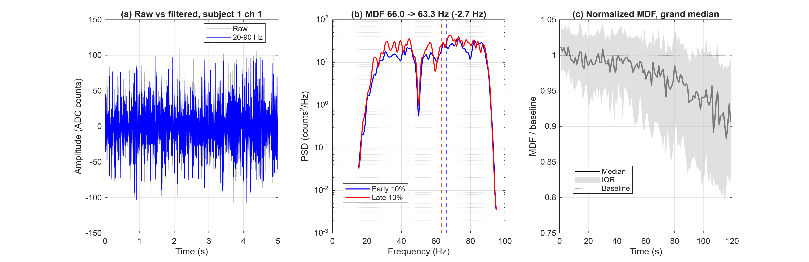

# Detecting Muscle Fatigue Onset from Surface EMG: A Comparative Study of Spectral and Time-Domain Features in MATLAB

**MATLAB Success Story | Category: Biomedical Signal Processing**

> Give the tool a multi-channel surface EMG recording of a sustained muscle effort. It cleans the signal, extracts spectral and time-domain fatigue indicators in sliding windows, and reports which indicator reveals the onset of fatigue earliest and most consistently, with every claim backed by a number and a figure produced by the code in this repository.



- Demo video / write-up: not supplied in the brief.
- Team: Akhtar Kael, Jennifer Jestina.
- Institution: Universitas Brawijaya, Malang, Indonesia.
- MATLAB release: R2026b Update 1 (`26.2.0.3433840`), from `results/run_info.json`.
- Products used here: base MATLAB plus the MATLAB unit-testing framework. The brief listed Signal Processing Toolbox and Statistics and Machine Learning Toolbox, and optional Wavelet Toolbox; none of the three is installed on this machine, so documented base-MATLAB substitutes are used. See `results/run_info.json` and `docs/formulation.md`.

---

## Contents

1. [Problem Statement](#1-problem-statement)
2. [Contribution and Positioning](#2-contribution-and-positioning)
3. [Research Questions and Hypotheses](#3-research-questions-and-hypotheses)
4. [Solution Approach](#4-solution-approach)
5. [How MATLAB Was Used](#5-how-matlab-was-used)
6. [How Generative AI Was Used](#6-how-generative-ai-was-used)
7. [Experiments](#7-experiments)
8. [Key Results](#8-key-results)
9. [Repository Structure and Data Contracts](#9-repository-structure-and-data-contracts)
10. [Implementation Record](#10-implementation-record)
11. [Getting Started](#11-getting-started)
12. [Limitations and Future Work](#12-limitations-and-future-work)
13. [Team](#13-team)
14. [References](#14-references)

---

## 1. Problem Statement

Muscle fatigue is a decline in the ability to produce force. Surface electromyography (sEMG) observes it non-invasively: during sustained effort, the spectrum tends to shift toward lower frequencies and the amplitude tends to rise. Many indicators exist, so a practitioner must choose one.

Two problems follow:

1. **Which indicator to trust.** Median frequency (MDF), mean frequency (MNF), RMS and mean absolute value (MAV) are all used, but they differ in consistency and timing. The choice is often habitual rather than comparative.
2. **A workflow that is hard to repeat.** Raw sEMG is noisy, quantized and recorded with varying hardware settings. Without a scripted pipeline, results are hard to reproduce.

This repository builds a reproducible MATLAB pipeline that loads a public multi-channel sEMG fatigue dataset, checks quality, filters and windows the signals, extracts four fatigue indicators, quantifies how strongly and how early each responds, validates the detector on synthetic signals with known onset, and reports where the classic hypotheses hold and where they do not.

## 2. Contribution and Positioning

This is not a new fatigue index or new signal-processing theory. The contribution is a transparent, reproducible comparison:

1. A complete scripted pipeline from raw recording to ranked indicators, with open code and one configuration struct.
2. An explicit definition of "onset": three stated criteria applied identically to every feature, with non-detections kept distinct from late detections.
3. Validation on synthetic signals with a known onset before trusting the detector on real data.
4. A robustness study over window length, overlap, filter band and baseline fraction.
5. Honest reporting: hypotheses are tested, and the classic spectral-dominance expectation is not supported here.

| | Classic sEMG fatigue literature | MathWorks EMG + deep-learning example | This work |
|---|---|---|---|
| Goal | Characterize spectral and amplitude changes | Classify forearm motions | Compare features for fatigue onset detection |
| Method | MDF/MNF, RMS and related indices | CNN sequence-to-sequence classification | Classical features, change detection, exploratory statistics |
| Dataset | Varies by study | Carleton myoelectric dataset, short motions | Public 8-channel fatigue dataset |
| Output | Trends and indices | Accuracy and confusion chart | Feature ranking, onset times, robustness, data-quality report |
| Interpretability | High | Lower | High |

Short notes on three recent papers and how they relate to this work are in [`docs/literature.md`](docs/literature.md).

## 3. Research Questions and Hypotheses

**RQ1.** Among MDF, MNF, RMS and MAV, which feature shows fatigue-related change most consistently and earliest in a sustained effort?

**RQ2.** Does the ranking depend on window length, overlap and filter band (also checked for baseline fraction)?

**RQ3.** Are the effects consistent across the eight channels and across subjects?

**RQ4 (optional).** Can the MDF decline be summarized by one fatigue time constant per subject?

| ID | Hypothesis | Expected direction |
|---|---|---|
| H1 | MDF and MNF decrease over the recording | Down |
| H2 | RMS and MAV increase over the recording | Up |
| H3 | Spectral features respond more consistently and earlier than amplitude features | MDF/MNF rank above RMS/MAV |

These hypotheses may fail for this dataset because of its low sampling rate, 8-bit resolution, already-applied notch filter, and one task type. Section 8 states the outcome from generated tables.

## 4. Solution Approach

### 4.1 Dataset

Primary dataset: Ebied et al., *Multi-channel Surface EMG Dataset for Fatigue analysis*, Zenodo, DOI `10.5281/zenodo.5189275`, CC BY 4.0. Associated paper: DOI `10.1109/NILES50944.2020.9257909`. The downloaded archive MD5 matched the value in the brief. The actual file layout, quality checks and the limited electrode information are documented in [`docs/dataset.md`](docs/dataset.md).

Important consequences:

- Sampling is 200 Hz, so the Nyquist limit is 100 Hz. The default band is 20–90 Hz, not the wider band common in higher-rate sEMG.
- A 50 Hz notch was already applied by the dataset authors; no second notch is applied by default.
- There is no fatigue label, force trace or self-reported score. "Onset" is defined by our criteria, not supplied by the data.
- The paper places channel 4 over the pronator teres and says numbering was consistent across subjects. It does not enumerate all eight muscles in extractable text, so channels remain numbered channels.

### 4.2 Pipeline

```
Raw sEMG (8 ch, 200 Hz)
  -> Stage 0: load + quality check                 (E1)
  -> Stage 1: DC removal via band-pass, 20-90 Hz   (base-MATLAB Butterworth)
  -> Stage 2: 2 s windows, 50% overlap
  -> Stage 3: RMS, MAV, MDF, MNF per window/channel
  -> Stage 4: baseline normalization + causal smoothing
  -> Stage 5: sensitivity metrics, onset, ranking   (E3, E4)
  -> Validation: synthetic known-onset signals      (E0)
  -> Sensitivity: trends, robustness, channels      (E2, E5, E6)
  -> Bonus: exponential MDF time constant            (E7)
```

Exact formulas, including the base-MATLAB substitutes and the documented O3 deviation, are in [`docs/formulation.md`](docs/formulation.md).

### 4.3 Preprocessing and features

The 4th-order Butterworth band-pass is designed with an analogue prototype and bilinear transform, then applied forward and backward with `filter` for zero phase. No Signal Processing Toolbox functions are used.

For every window and channel:

| Feature | Definition | Expected direction |
|---|---|---|
| `rms` | `sqrt(mean(x.^2))` | Up |
| `mav` | `mean(abs(x))` | Up |
| `mdf` | Median frequency of the Welch PSD in 20–90 Hz | Down |
| `mnf` | Mean frequency of the Welch PSD in 20–90 Hz | Down |

The Welch PSD uses analytic Hamming windows of 200 samples with 100 samples of overlap and a 512-point FFT. MDF and MNF are computed with cumulative and ordinary trapezoidal integration. The optional `wlr` is skipped because Wavelet Toolbox is not installed.

### 4.4 Normalization, metrics and onset

Each feature is divided by the mean of the first 10% of that subject/channel's windows, producing a baseline value of 1, then smoothed with a trailing 5-window mean. This introduces about a 2-window lag in O1 and O2.

Expected signs are +1 for RMS/MAV and −1 for MDF/MNF. All metrics are sign-adjusted so positive means "changed in the expected fatigue direction":

- **M1**: Spearman correlation with time.
- **M2**: OLS slope in percent of baseline per minute.
- **M3**: Cohen's *d*, last 20% versus first 20% of windows.
- **M4**: onset time.

Onset criteria:

- **O1 (primary)**: first window of the first run of 3 consecutive windows with `s * (y - 1) / baselineStd >= 3`.
- **O2**: same run rule with `s * (y - 1) >= 0.10`.
- **O3**: single two-segment least-squares change point. This replaces `findchangepts` and uses the smoothed normalized series; see `docs/formulation.md`.

Detection rate is reported separately from median onset time. A feature that rarely crosses its threshold is not treated as "late".

### 4.5 Inference

Channels are collapsed to one median per subject before any statistical comparison. Inference is therefore across 15 subjects, never across correlated windows. Paired comparisons use Wilcoxon signed-rank with Holm correction; a Friedman test is the omnibus check on M3. With n = 15, p-values are exploratory and effect sizes are emphasized.

## 5. How MATLAB Was Used

| Capability | Use in this repository |
|---|---|
| Base MATLAB | Data loading, numeric filtering, FFT/Welch PSD, feature extraction, statistics, tables, figures |
| MATLAB unit-testing framework | Nine acceptance tests in `tests/` |
| `fminsearch` (base MATLAB) | Optional exponential time-constant fit in E7 |
| Signal Processing Toolbox functions in the brief | Not installed; replaced by documented base-MATLAB code |
| Statistics and Machine Learning Toolbox functions in the brief | Not installed; Spearman, Wilcoxon, Friedman and Holm implemented locally |
| Wavelet Toolbox | Not installed; `wlr` skipped and logged |
| Simulink | Not used; the brief's model-parameter-estimation analogy is conceptual only |

Installed products, skipped features and substitutes are recorded in `results/run_info.json`.

## 6. How Generative AI Was Used

Tools actually used: an OpenCode coding agent with the MATLAB MCP server, plus web/DOI lookups and `pdftotext` for the bundled paper. MATLAB Copilot and GitHub Copilot were not used.

| Stage | How AI was used | Verification |
|---|---|---|
| Dataset search and inspection | Suggested layout checks and parsed the downloaded archive | Zenodo/DOI pages checked; MAT and TXT files loaded in MATLAB; see `docs/dataset.md` |
| Planning and design | Drafted feature definitions, onset rules and experiment structure | Compared with literature and tested on synthetic signals |
| Code | Drafted pipeline functions, tests, figures and tables | `runtests('tests')` passed 9/9; full `main` run completed |
| Debugging | Diagnosed shape, table-orientation and gain errors | Each fix rechecked against the relevant CSV or unit test |
| Documentation | Drafted this README and the `docs/` files | Numbers checked against `results/tables/`; no unstated dataset facts kept |

Examples where AI output was wrong and caught:

- Passband gain was first computed from the real part of a complex transfer-function ratio; corrected to `1/abs(H0)` and verified by the filter-gain test.
- Feature arrays collapsed to row vectors for one channel; corrected with explicit transposes.
- Trend, ranking, robustness and channel tables initially had transposed or misaligned columns; corrected and rechecked against CSV headers.
- Five E7 exponential fits hit the 1000 s tau bound; they are flagged `usableFit = 0` rather than reported as successful.
- The E4 paired test initially took the first two entries of `cfg.featureNames` (RMS and MAV) while the table was labelled MDF vs RMS; corrected to explicit feature names and regenerated `E4_onset_pairwise.csv`.

The full working record is in [`docs/genai_log.md`](docs/genai_log.md).

## 7. Experiments

All reported experimental outcomes in this section come from CSV files in `results/tables/`; design constants such as window length and thresholds come from `config/defaultConfig.m` and the experiment scripts. No noise-amplitude sweep was run; E0's band-limited mixed noise and stationary null are the noise checks actually implemented.

### E0 — synthetic validation

Fifty seeded 120 s signals with onset at 40 s, plus 100 stationary signals. O1 acceptance tolerance: 12 s. Source: `E0_synthetic.csv`.

| Feature | True onset (s) | Detected O1 (s) | Absolute error (s) | Pass rate | Stationary false-positive rate |
|---|---:|---:|---:|---:|---:|
| MDF | 40 | 40 | 0 | 1.00 | 0.01 |
| MNF | 40 | 39 | 1 | 1.00 | 0.02 |
| RMS | 40 | 45 | 5 | 0.98 | 0.01 |
| MAV | 40 | 45 | 5 | 1.00 | 0.02 |

Spectral features recover the known onset more precisely than amplitude features in this synthetic test.

### E1 — signal quality and filtering

Source: `E1_quality.csv` (120 rows: 15 subjects × 8 channels). Samples per channel range from 24,049 to 24,193, corresponding to 120.245–120.965 s at 200 Hz. Distinct amplitude levels range from 40 to 256, median 245.5. No flat channels were found. The fraction of samples equal to a channel's own minimum or maximum has median 0.001309 and maximum 0.08783. `docs/media/hero.png` and `results/figures/E1_quality.png` show subject 1, channel 1 before and after filtering.

### E2 — feature trends

Sources: `E2_trends.csv` and `E2_spectralShift.csv`. The absolute early-versus-late shift is the median across subject-channel pairs; early and late are the first and last 10% of windows, respectively.

| Feature | Early median (Hz) | Late median (Hz) | Shift (Hz) |
|---|---:|---:|---:|
| MDF | 63.737 | 55.745 | −7.992 |
| MNF | 59.873 | 55.883 | −3.990 |

At the last recorded window centre, `t_s = 119` s, the grand-median normalized values are RMS 1.428, MAV 1.428, MDF 0.901 and MNF 0.938.

### E3 — sensitivity ranking

Source: `E3_ranking.csv`. M1, M2 and M3 are medians across subjects after collapsing channels; IQR is in brackets. Direction counts are out of 15 subjects. Ranking is by descending M3.

| Feature | M1 [IQR] | M2 (%/min) [IQR] | M3 [IQR] | Direction as expected | Rank by M3 |
|---|---:|---:|---:|---:|---:|
| MAV | 0.780 [0.280] | 23.630 [13.868] | 4.269 [2.760] | 15/15 | 1 |
| RMS | 0.785 [0.287] | 22.893 [14.963] | 4.192 [2.636] | 15/15 | 2 |
| MNF | 0.611 [0.280] | 3.110 [1.504] | 2.017 [1.285] | 15/15 | 3 |
| MDF | 0.580 [0.271] | 5.126 [2.283] | 1.947 [1.380] | 15/15 | 4 |

WLR is not in the table: Wavelet Toolbox is unavailable, and this is logged in `results/run_info.json`.

Omnibus and paired tests:

- Friedman on subject-level M3: Q = 11.4, p = 0.00975, four features, 15 subjects (`E3_friedman.csv`).
- Six paired Wilcoxon comparisons on M3: none is significant after Holm correction. The smallest adjusted p is 0.10235 (`E3_pairwise.csv`).

The ranking is therefore a consistent descriptive ordering, not a set of statistically separated feature pairs.

### E4 — onset detection comparison

Source: `E4_onsets.csv`. Detection rate is over 120 subject-channel pairs; median onset is computed only over detected pairs.

| Feature | Detection rate O1 | Median O1 (s) | Detection rate O2 | Median O2 (s) | Median O3 (s) |
|---|---:|---:|---:|---:|---:|
| MDF | 0.408 | 79.5 | 0.625 | 54 | 59 |
| MNF | 0.450 | 88 | 0.400 | 95 | 53 |
| RMS | 0.825 | 48 | 0.925 | 21 | 54 |
| MAV | 0.842 | 47 | 0.925 | 20.5 | 55.5 |

Planned paired comparison (`E4_onset_pairwise.csv`): MDF versus RMS under O1, using the 15 subjects where both were detected. Median paired difference (MDF − RMS) is 27 s, raw p = 0.01460, Holm-adjusted p = 0.01460. This Holm family contains one test, so adjustment leaves p unchanged. The paired median differs from the unpaired medians in the main table because it uses only jointly detected subjects.

### E5 — robustness to analysis choices

Source: `E5_robustness.csv`. "Same" compares the entire four-feature order with the default order, `mav > rms > mnf > mdf`.

| Setting | Value | Ranking by M3 | Same order? |
|---|---|---|---|
| Default | 2 s, 0.5, [20 90], 0.10 | mav > rms > mnf > mdf | n/a |
| Window | 1 s | mav > rms > mnf > mdf | Yes |
| Window | 4 s | rms > mav > mnf > mdf | No |
| Overlap | 0 | rms > mav > mnf > mdf | No |
| Overlap | 0.75 | mav > rms > mnf > mdf | Yes |
| Band | [10 90] | rms > mav > mnf > mdf | No |
| Band | [30 90] | mav > rms > mnf > mdf | Yes |
| Baseline | 0.05 | mav > rms > mnf > mdf | Yes |
| Baseline | 0.20 | mav > rms > mnf > mdf | Yes |

The full order is unchanged in 6 of the 9 settings. In the three changed settings, the top two swap but MNF still precedes MDF.

### E6 — channel consistency

Source: `E6_channels.csv`. Cells are fractions of the 15 subjects with positive M3 for that channel and feature.

| Channel | RMS | MAV | MDF | MNF |
|---:|---:|---:|---:|---:|
| 1 | 0.933 | 0.933 | 0.600 | 0.667 |
| 2 | 1.000 | 0.933 | 0.600 | 0.733 |
| 3 | 0.733 | 0.733 | 0.800 | 0.867 |
| 4 | 0.800 | 0.800 | 1.000 | 1.000 |
| 5 | 1.000 | 1.000 | 0.867 | 0.867 |
| 6 | 0.933 | 0.933 | 1.000 | 1.000 |
| 7 | 0.933 | 0.933 | 0.933 | 0.933 |
| 8 | 0.933 | 0.933 | 0.933 | 0.867 |

Amplitude features are at least 0.733 in every channel. Spectral features reach 1.000 in channels 4 and 6 but range from 0.600 to 0.733 in channels 1 and 2.

### E7 — fatigue time constant (bonus)

Sources: `E7_timeConstant.csv` and `E7_summary.csv`. Seven of 15 subject fits meet the `R^2 >= 0.3` usability criterion. For those seven, median tau is 354.4 s and median R² is 0.423. Tau is longer than the roughly 120 s recording for most usable fits, and eight fits are poor; this experiment is a descriptive curve summary, not evidence of a physiological time constant.

### E8 — early-versus-late classification (not run)

Not implemented. `fitcsvm` is unavailable, and labels defined only by time position would not be an independent fatigue label. The skip is recorded in `results/run_info.json`.

## 8. Key Results

- **Cleaning and spectral shift.** The hero figure shows subject 1 channel 1 before and after band-pass filtering, plus the early-versus-late PSD. Across subject-channel pairs, MDF falls from 63.737 Hz to 55.745 Hz (−7.992 Hz) and MNF falls from 59.873 Hz to 55.883 Hz (−3.990 Hz) (`E2_spectralShift.csv`). At `t_s = 119` s the normalized medians are MDF 0.901, MNF 0.938, RMS 1.428 and MAV 1.428 (`E2_trends.csv`).
- **Feature ranking.** By M3 the order is MAV (4.269), RMS (4.192), MNF (2.017), MDF (1.947); all four features change in the expected direction for 15/15 subjects (`E3_ranking.csv`). The Friedman check is Q = 11.4, p = 0.00975 (`E3_friedman.csv`), but no individual pair survives Holm correction (smallest adjusted p = 0.10235, `E3_pairwise.csv`).
- **Onset.** Under O1, MAV and RMS are detected in 0.842 and 0.825 of subject-channel pairs with median onsets of 47 s and 48 s; MDF and MNF are detected in 0.408 and 0.450 with median onsets of 79.5 s and 88 s (`E4_onsets.csv`). Detection rate and onset time must be read together.
- **Robustness.** The full ranking is unchanged in 6 of 9 settings; a 4 s window, zero overlap, or a 10–90 Hz band swaps only MAV and RMS (`E5_robustness.csv`).
- **H1 — supported.** MDF and MNF decrease for 15/15 subjects and their absolute shifts are −7.992 Hz and −3.990 Hz (`E2_spectralShift.csv`, `E3_ranking.csv`).
- **H2 — supported.** RMS and MAV increase for 15/15 subjects and finish above baseline at 1.428 and 1.428 normalized units (`E3_ranking.csv`, `E2_trends.csv`).
- **H3 — not supported.** Amplitude features outrank spectral features by M3 (MAV 4.269 versus MDF 1.947) and have higher O1 detection rates and earlier median detected onsets. The pairwise M3 differences are not Holm-significant, so this is a descriptive reversal of the expected order, not a significant feature separation (`E3_ranking.csv`, `E3_pairwise.csv`, `E4_onsets.csv`).

**Headline:** On this dataset, **MAV** showed the largest effect size (median *d* = 4.269) and the earliest detected O1 onset (median 47 s), 32.5 s earlier than MDF (median 79.5 s), with the caveat that those medians are conditional on detection and the M3 pair was not statistically separated after Holm correction.

## 9. Repository Structure and Data Contracts

```text
.
├── README.md
├── main.m                      % runs E0-E7 from scratch
├── downloadData.m              % downloads, MD5-verifies and unzips the dataset
├── config/defaultConfig.m      % every parameter in one struct
├── +data/                      % loadDataset.m, qualityCheck.m
├── +preproc/                   % bandpassEMG.m, segmentWindows.m
├── +features/                  % timeDomain.m, spectral.m, welchPSD.m, extractAll.m
├── +analysis/                  % normalization, onset, metrics, ranking, E7 fit
├── +synth/                     % makeSyntheticFatigue.m
├── +viz/                       % one function per figure, including heroFigure.m
├── experiments/                % run_E0.m ... run_E7.m
├── tests/                      % matlab.unittest acceptance tests
├── data/raw/                   % not committed; created by downloadData.m
├── results/
│   ├── figures/                % labelled PNGs, 300 dpi where printed
│   ├── tables/                 % CSV source of Section 7 and 8 numbers
│   └── run_info.json           % release, products, seed, config, skips, substitutes
└── docs/
    ├── dataset.md
    ├── formulation.md
    ├── genai_log.md
    ├── literature.md
    └── media/hero.png
```

| From → to | Structure |
|---|---|
| Loader → pipeline | `subjects` struct array: `id`, `emg` (N × 8 double), `fs`, `source` |
| Preprocessing → features | Filtered N × 8 matrix and `cfg.fs` |
| Segmentation → features | `win` (winLen × nWin × 8), `tc` (nWin × 1 window-centre seconds) |
| Features → analysis | Long table `T`: `subject`, `channel`, `win`, `t_s`, `rms`, `mav`, `mdf`, `mnf` |
| Normalization | Same table plus `<feature>_n`, `<feature>_s`, `<feature>_bstd` |
| Metrics | `subject`, `channel`, `feature`, `M1`, `M2`, `M3`, `onset_O1`, `onset_O2`, `onset_O3`, `directionOK` |
| Config | `cfg` from `config/defaultConfig.m` |

Defaults: `fs = 200`, `band = [20 90]`, `filtOrder = 4`, `applyNotch = false`, `winSec = 2`, `overlap = 0.5`, `specBand = [20 90]`, `baselineFrac = 0.10`, `smoothWin = 5`, `zThresh = 3`, `kConsec = 3`, `pctThresh = 0.10`, `earlyLateFrac = 0.20`, `seed = 0`.

## 10. Implementation Record

| Task | Status |
|---|---|
| Download, MD5 verify, unzip, inspect files | Complete; recorded in `docs/dataset.md` |
| Loader for MAT and TXT sources | Complete; real data loaded as 15 subjects × 8 channels |
| Per-subject/channel quality table | Complete; `E1_quality.csv` |
| Configuration struct and preprocessing | Complete; base-MATLAB Butterworth with zero-phase filtering |
| Feature extraction and synthetic generator | Complete; tests for RMS, MAV, MDF, MNF and filter gain pass |
| Normalization, onset, metrics and ranking | Complete; sign conventions tested |
| Experiments E0–E6 | Complete; CSVs and figures present |
| Main entry point and provenance | Complete; `main` writes `results/run_info.json` |
| Bonus E7 | Complete; fit quality flagged, summary CSV written |
| Bonus E8 | Skipped and logged: unavailable `fitcsvm` and no independent labels |
| Wavelet ratio | Skipped and logged: Wavelet Toolbox unavailable |
| Unit tests | 9 passed, 0 failed, 0 incomplete |
| Full pipeline run | Completed in 73.6 s on the final verification run on the tested Windows machine |

Notable deviations from the supplied README are logged in `docs/formulation.md` and `docs/genai_log.md`: base-MATLAB substitutes, O3 using the smoothed normalized series, no noise sweep, and the E7 fit-quality flag.

## 11. Getting Started

**Requirements:** MATLAB R2026b Update 1 or a compatible release. No additional toolbox is required for this implementation. The dataset is about 10.6 MB.

```matlab
% 1. Open this folder in MATLAB
% 2. Download and verify the dataset
downloadData

% 3. Run the acceptance tests
runtests("tests")

% 4. Run the full pipeline (E0-E7)
main
```

Expected output: 9 passing tests, then tables in `results/tables/`, figures in `results/figures/`, the hero figure in `docs/media/hero.png`, and provenance in `results/run_info.json`. Measured run time on the tested machine is about 74 s for `main`.

To use a different recording, provide a `subjects` struct with `emg` as samples × channels and `fs` in Hz, and keep every `cfg.band` upper cutoff below `fs/2`.

## 12. Limitations and Future Work

- **No independent fatigue ground truth.** Onset means departure from baseline under our criteria, not a physiologically confirmed fatigue boundary.
- **Low bandwidth and resolution.** The 200 Hz / 8-bit Myo-armband recording loses high-frequency content and has coarse amplitude quantization. Conclusions may not transfer to 1–2 kHz lab recordings.
- **One task, small sample.** Fifteen subjects, one 6 kg isometric elbow-flexion task. Only channel 4 has a stated muscle name; other channels are not assigned to muscles.
- **Already notch-filtered.** The 50 Hz notch distorts the spectrum near 50 Hz in all windows.
- **Correlated windows.** Window-level values are descriptive; inference is across 15 subjects and remains exploratory.
- **Free onset parameters.** Thresholds, run length and smoothing affect O1/O2. E0 and E5 probe sensitivity but cannot remove this choice.
- **Ranking is descriptive.** The Friedman test is significant, but no M3 pair survives Holm correction.
- **E7 is not a validated physiological model.** Only 7/15 fits are usable and most usable tau values exceed the recording duration.
- **Substitutes differ from toolbox references.** Base-MATLAB Welch, rank tests and change-point search are documented, but results are not claimed identical to toolbox implementations.
- **Not a clinical tool.** This is a workflow demonstration and makes no diagnostic claim.

Future work: validate on a dataset with independent fatigue labels and higher bandwidth, include dynamic contractions, test additional time-frequency and nonlinear indices, relate onset to force decline or self-reported effort, and package the workflow as an App Designer front end.

## 13. Team

| Member | Notes |
|---|---|
| **Akhtar Kael** | Named in the repository README; role assignment was not stated and was not invented |
| **Jennifer Jestina** | Named in the repository README; role assignment was not stated and was not invented |
| Both | Human review of agent-written code and final traceability check of Section 8 numbers |

## 14. References

1. A. Ebied, A. M. Awadallah, M. A. Abbass, and Y. El-Sharkawy, *Multi-channel Surface EMG Dataset for Fatigue analysis*, Zenodo, 2021. DOI `10.5281/zenodo.5189275`. CC BY 4.0. *Primary dataset.*
2. A. Ebied, A. M. Awadallah, M. A. Abbass, and Y. El-Sharkawy, "Upper Limb Muscle Fatigue Analysis Using Multi-channel Surface EMG," *NILES 2020*, pp. 423–427. DOI `10.1109/NILES50944.2020.9257909`. *Source paper; channel 4 placement and task protocol.*
3. C. J. De Luca, "Myoelectrical manifestations of localized muscular fatigue in humans," *Critical Reviews in Biomedical Engineering*, 11(4), 251–279, 1984. PMID 6391814. *Classical spectral-shift rationale.*
4. M. Cifrek, V. Medved, S. Tonković, and S. Ostojić, "Surface EMG based muscle fatigue evaluation in biomechanics," *Clinical Biomechanics*, 24(4), 327–340, 2009. DOI `10.1016/j.clinbiomech.2009.01.010`. *Review of fatigue indices.*
5. M. Gazzoni, A. Botter, and T. M. M. Vieira, "Surface EMG and muscle fatigue: multi-channel approaches to the study of myoelectric manifestations of muscle fatigue," *Physiological Measurement*, 38(5), R27, 2017. DOI `10.1088/1361-6579/aa60b9`. *Multi-channel motivation.*
6. A. Phinyomark, P. Phukpattaranont, and C. Limsakul, "Feature reduction and selection for EMG signal classification," *Expert Systems with Applications*, 39(8), 7420–7431, 2012. DOI `10.1016/j.eswa.2012.01.102`. *Time-domain feature background.*
7. F. N. Jamaluddin, F. Ibrahim, and S. A. Ahmad, "A New Approach to Noninvasive-Prolonged Fatigue Identification Based on Surface EMG Time-Frequency and Wavelet Features," *Journal of Healthcare Engineering*, 2023, 1951165. DOI `10.1155/2023/1951165`. *Recent time-frequency context.*
8. G. Cho et al., "Characterization of signal features for real-time sEMG onset detection," *Biomedical Signal Processing and Control*, 84, 104774, 2023. DOI `10.1016/j.bspc.2023.104774`. *Recent onset-detection context.*
9. S. M. Cerqueira, R. Vilas Boas, J. Figueiredo, and C. P. Santos, "A Comprehensive Dataset of Surface Electromyography and Self-Perceived Fatigue Levels for Muscle Fatigue Analysis," *Sensors*, 24(24), 8081, 2024. DOI `10.3390/s24248081`. *Candidate labelled dataset for future validation.*
10. J. Lim, L. Lu, K. Goonewardena, J. Z. Liu, and Y. Tan, "Assessment of Self-report, Palpation, and Surface Electromyography Dataset During Isometric Muscle Contraction," *Scientific Data*, 11, 208, 2024. DOI `10.1038/s41597-024-03030-8`. *Optional second dataset in the brief; not used here.*
11. MathWorks, *Classify Arm Motions Using EMG Signals and Deep Learning*. <https://www.mathworks.com/help/signal/ug/classify-arm-motions-using-emg-signals-and-deep-learning.html>
12. MathWorks, *Muscle Reflex Parameter Estimation*. <https://www.mathworks.com/help/sldo/ug/muscle-reflex-parameter-estimation.html> *Conceptual presentation reference for the E7 parameter fit.*

## Acknowledgements

The dataset authors released their data under CC BY 4.0, which made this study possible. All analysis code in this repository was checked with unit tests and an end-to-end run; see Section 6 and `docs/genai_log.md` for how generative AI was used.

## Licence

The code licence was not specified in the supplied brief. The dataset retains its own CC BY 4.0 licence and is not redistributed in this repository.
